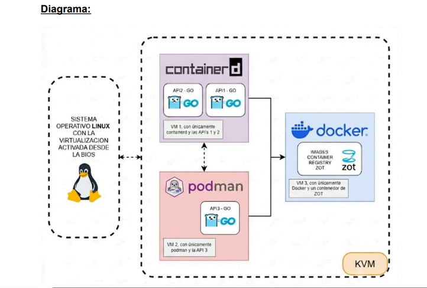

# Manual Técnico - Desarrollo, Conexion y Gestión de Contenedores en Entornos Virtualizados.

**Estudiante: David Chanquin

**Carnet: 202300611

**Curso: Sistemas Operativos 1, Facultad de Ingeniería, USAC

##  Resumen Ejecutivo

El presente documento detalla el diseño, configuración e implementación de un entorno virtualizado enfocado en la contenerización y gestión de servicios. El objetivo de este proyecto es simular una infraestructura moderna usando herramientas como máquinas virtuales (VMs), Docker, Containerd, Podman, el lenguaje Go y el registro de imágenes Zot. A través de esta arquitectura se gestiona el despliegue de tres APIs independientes que se comunican entre sí validando su estado operativo.

##  Arquitectura del Sistema

El sistema se construyó sobre un sistema operativo anfitrión Linux Mint, utilizando la tecnología KVM para la virtualización. Se crearon tres máquinas virtuales distintas, cada una aislada y con un propósito y runtime de contenedores específico:

### VM 1:
Utiliza Containerd como motor de contenedores y aloja las API 1 y API 2

### VM 2:
Utiliza Podman como motor de contenedores y aloja la API 3.

### VM 3:
Utiliza Docker y se encarga exclusivamente de ejecutar el contenedor del Registro Privado Zot.

##  Diagrama de Arquitectura
Diagrama de la distribución de las máquinas virtuales y sus respectivos runtimes

##  Configuración de la Infraestructura y Runtimes

### 3.1. Virtualización con KVM
Las tres máquinas virtuales fueron desplegadas utilizando qemu-kvm desde el host. Cada máquina cuenta con una dirección IP estática dentro de la misma subred (192.168.122.x) para garantizar la conectividad entre las APIs y el registro privado de imágenes.

### 3.2. Instalación de Runtimes
Para garantizar que cada VM cumpla su propósito sin conflictos, se instalaron los motores de forma independiente:

#### VM1 (Containerd): 
Se instaló y habilitó el servicio containerd de forma nativa. La gestión de contenedores e imágenes se realiza a nivel de sistema mediante el comando ctr.

#### VM2 (Podman):
Se instaló Podman, un motor daemonless que permite ejecutar contenedores sin necesidad de un proceso en segundo plano continuo como Docker.

#### VM3 (Docker):
Se instaló Docker Engine para gestionar el servidor de registro de imágenes.

## Desarrollo y Contenerización de APIs

### Construcción de los Servicios:
Las tres APIs (API1, API2, API3) fueron desarrolladas utilizando el lenguaje de programación Go. Se optó por Go debido a su alta eficiencia en la compilación y su naturaleza ideal para el desarrollo de microservicios y contenedores ligeros, ademas que asi lo pide el pdf.

### Creación de Imágenes
Para cada API se redactó un Dockerfile utilizando el enfoque multi-stage build. Esto permite compilar el código de Go en una etapa base y trasladar únicamente el binario ejecutable a una imagen Alpine final, reduciendo drásticamente el peso del contenedor.

Los nombres de las imágenes se definieron respetando estrictamente el formato [ API#-#CARNET ]. Se les asignó el tag :latest. Las imágenes construidas son:

#### api1-202300611:latest
#### api2-202300611:latest
#### api3-202300611:latest

### Zot Registry
El registro privado Zot se desplegó en la VM3 exponiendo el puerto 5000. Todas las imágenes construidas se subieron (Push) a este registro centralizado. Luego, la VM1 y VM2 realizaron la descarga (Pull) de sus respectivas imágenes desde la dirección IP de la VM3 para ejecutar los contenedores de las APIs de forma local.

## Flujo de Comunicación y Endpoints
Las APIs se comunican utilizando el protocolo REST/HTTP y el formato de datos JSON. Cada API independiente cuenta con los siguientes endpoints:

### Endpoint de Salud (/health)

Endpoint fundamental que responde siempre con un status 200 OK y el siguiente formato JSON para confirmar que la API se encuentra operativa:

{
  "status": "UP",
  "message": "API# is Ready",
  "timestamp": "2026-08-19T10:30:00Z",
  "VM": #vm,
  "carnet": "202300611"
}

### Endpoints de Llamadas Cruzadas (/api#/#CARNET/call-api#)

Este endpoint describe el flujo de comunicación principal del sistema. Cuando un usuario realiza una petición a una API (por ejemplo. API2), esta se encarga de contactar internamente mediante una petición HTTP al endpoint /health de otra API (por ejemplo. API1).

#### Manejo de Respuestas:

Éxito: Si la API consultada (API1) responde correctamente con "status": "UP", la API principal (API2) devuelve:

{
  "apiname": "API1",
  "message": "The API1 located on the VM1 is working",
  "connection": true,
  "carnet": "202300611"
}

Fallo / Manejo de Errores: Si la API consultada se encuentra apagada o no responde correctamente, se atrapa la excepción y se devuelve un estado de conexión falso indicando el problema:  

{
  "apiname": "API1",
  "message": "ERROR: The API1 located on the VM1 is not working",
  "connection": false,
  "carnet": "202300611"
}