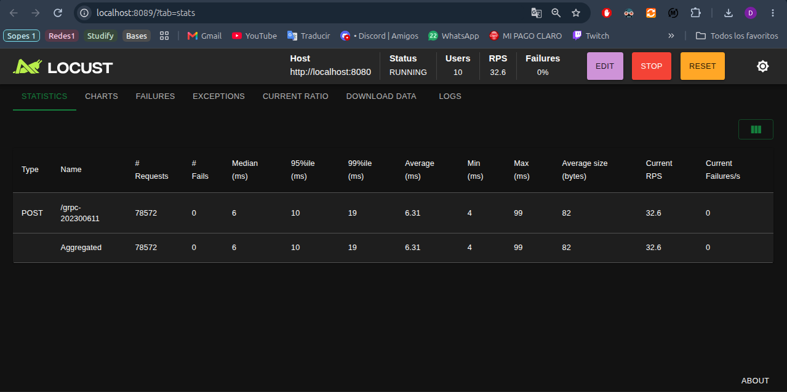
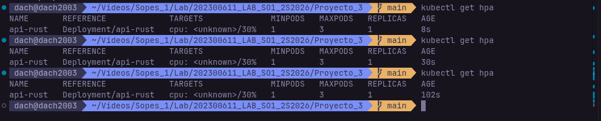
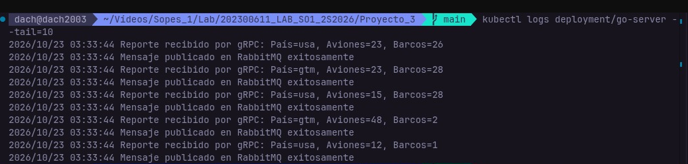
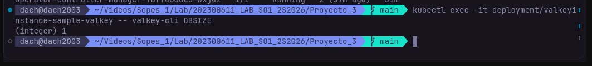
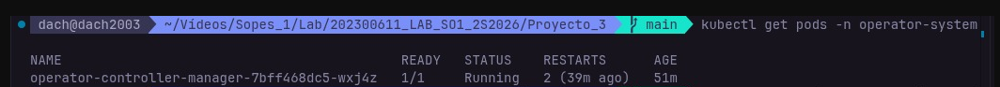
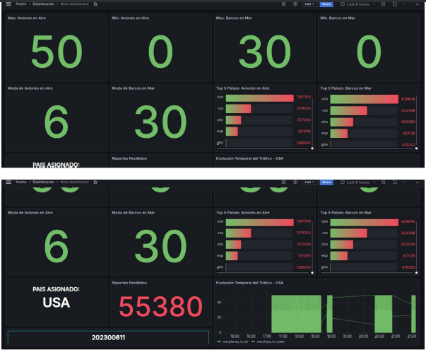
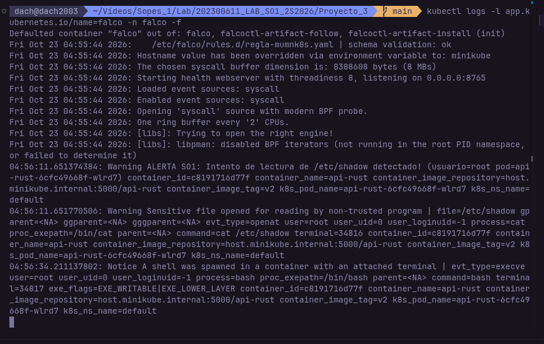
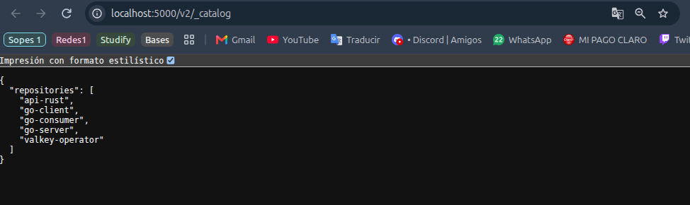

# Manual Técnico - Proyecto #3: M.U.M.N.K8s
## Monitoreo de Unidades Militares en la Nube con Kubernetes

**Universidad San Carlos de Guatemala**  
**Facultad de Ingeniería - Escuela de Ciencias y Sistemas**  
**Sistemas Operativos 1 - Segundo Semestre 2026**  
**Nombre:** David Arturo Chanquin Velasquez  
**Carnet:** `202300611`  
**País Asignado:** `USA` (Estados Unidos)  
**Ruta de Exposición:** `/grpc-202300611`  

---

## 1. Resumen Ejecutivo y Objetivos

El proyecto M.U.M.N.K8s consiste en el diseño, implementación y despliegue de una arquitectura de microservicios distribuida, resiliente y de alta concurrencia orientada a la recepción, procesamiento, encolamiento, almacenamiento y visualización de reportes militares simulados en tiempo real.

### Objetivos Principales:
1. **Exposición Moderna**: Utilizar la especificación Kubernetes Gateway API en sustitución de los tradicionales Ingress Controllers, enrutando el tráfico de prueba de Locust hacia la ruta personalizada `/grpc-202300611`.
2. **Escalabilidad Elástica**: Configurar Horizontal Pod Autoscaler (HPA) sobre el despliegue de Rust para autoescalar de 1 a 3 réplicas cuando el consumo de CPU supera el 30%.
3. **Comunicación de Alto Rendimiento**: Implementar comunicación gRPC binaria basada en HTTP/2 y Protocol Buffers (proto3) entre microservicios escritos en Go.
4. **Mensajería Asíncrona Desacoplada**: Integrar **RabbitMQ** como broker de mensajería para garantizar tolerancia a picos de carga.
5. **Extensibilidad de Kubernetes (Operators)**: Desarrollar un operador basado en Helm (Operator SDK) que administre el ciclo de vida de Valkey (almacenamiento en memoria con persistencia PVC) y Grafana (con provisionamiento automático de dashboards y datasources) como Custom Resources declarativos.
6. **Seguridad y Observabilidad en Tiempo Real**: Implementar Falco para auditoría a nivel de syscalls del kernel de Linux y detección de accesos no autorizados a archivos sensibles.
7. **Registro Privado Seguro**: Alojar y distribuir todas las imágenes de contenedores mediante Zot Container Registry bajo protocolo HTTPS.

---

## 2. Arquitectura General del Sistema

A continuación se ilustra la arquitectura de componentes y el flujo secuencial de los datos:

```text
+-----------------------------------------------------------------------------------------------------+
|                                          TRÁFICO EXTERNO                                            |
|                                                                                                     |
|   +-------------------+                                                                             |
|   |   Locust (Load)   | (Peticiones POST HTTP con reportes JSON: país, aviones, barcos, timestamp)  |
|   +---------+---------+                                                                             |
+-------------|---------------------------------------------------------------------------------------+
              |
              v
+-------------|---------------------------------------------------------------------------------------+
|             |                       CLÚSTER DE KUBERNETES (mumnk8s)                                 |
|             v                                                                                       |
|   +-------------------+                                                                             |
|   |    Gateway API    |  (api-gateway: puerto 80)                                                   |
|   |    HTTPRoute      |  (Regla de path: /grpc-202300611)                                           |
|   +---------+---------+                                                                             |
|             |                                                                                       |
|             v                                                                                       |
|   +-------------------+                                                                             |
|   |  API REST (Rust)  | <========> [ HPA (1 - 3 réplicas si CPU > 30%) ]                            |
|   |      (Axum)       |                                                                             |
|   +---------+---------+                                                                             |
|             | (HTTP POST /report)                                                                   |
|             v                                                                                       |
|   +-------------------+                                                                             |
|   |  Go Deployment 1  |                                                                             |
|   |   (gRPC Client)   | (Serializa a protobuf: wartweets.WarReportRequest)                          |
|   +---------+---------+                                                                             |
|             | (gRPC / HTTP/2 - go-server-svc:50051)                                                 |
|             v                                                                                       |
|   +-------------------+                                                                             |
|   |  Go Deployment 2  |                                                                             |
|   |   (gRPC Server &  |                                                                             |
|   |  RabbitMQ Writer) |                                                                             |
|   +---------+---------+                                                                             |
|             | (Publicación AMQP a cola: war_reports)                                                |
|             v                                                                                       |
|   +-------------------+                                                                             |
|   |     RabbitMQ      | (Broker de colas durable)                                                   |
|   |   Message Broker  |                                                                             |
|   +---------+---------+                                                                             |
|             | (Consumo concurrente)                                                                 |
|             v                                                                                       |
|   +-------------------+                                                                             |
|   |  Go Deployment 3  |                                                                             |
|   |  (Rabbit Consumer | (Calcula máx, mín, moda, top 5 y stream para país asignado USA)             |
|   |   & Valkey Ingest)|                                                                             |
|   +---------+---------+                                                                             |
|             | (Redis Protocol)                                                                      |
|             +-----------------------+                                                               |
|                                     |                                                               |
|   +=================================v===================================+                           |
|   |               ADMINISTRADO POR HELM-BASED OPERATOR                  |                           |
|   |                                                                     |                           |
|   |   +--------------------------+       +--------------------------+   |                           |
|   |   |   CR: ValkeyInstance     |       |   CR: GrafanaInstance    |   |                           |
|   |   | (StatefulSet + PVC + Svc)|       | (Deployment + ConfigMaps)|   |                           |
|   |   |         [Valkey]         | <---- |        [Grafana]         |   |                           |
|   |   +--------------------------+       +--------------------------+   |                           |
|   +=====================================================================+                           |
|                                                                                                     |
|   +---------------------------------------------------------------------+                           |
|   | Falco Runtime Security: Audita syscalls / detecta lectura de ficheros|                           |
+---+---------------------------------------------------------------------+---------------------------+
              ^
              | Descarga de Imágenes Docker
+-------------|---------------------------------------------------------------------------------------+
|   +---------+---------+                                                                             |
|   |    Zot Registry   | (HTTPS en puerto 5000)                                                      |
|   +-------------------+                                                                             |
+-----------------------------------------------------------------------------------------------------+
```

---

## 3. Detalle de Componentes y Flujo de Datos

### 3.1. Estructura de Mensajes
Cada reporte militar generado por Locust cuenta con el siguiente esquema JSON:

```json
{
  "country": "USA",
  "warplanes_in_air": 42,
  "warships_in_water": 14,
  "timestamp": "2026-10-22T20:15:30Z"
}
```
* **Países válidos**: `USA`, `RUS`, `CHN`, `ESP`, `GTM`.
* **Rangos simulados**:
  * Aviones en el aire: entre 0 y 50.
  * Barcos en el mar: entre 0 y 30.

> 

---

### 3.2. Capa de Ingesta: API REST en Rust y HPA
* **Rutas**:
  * `POST /grpc-202300611`: Recibe el reporte militar desde Locust.
* **Mecanismo de Estrés y HPA**:
  Para permitir el autoescalado, el Deployment de Rust está configurado con un límite de recursos de CPU. Bajo carga de Locust, la utilización promedio de CPU del Pod supera rápidamente el umbral del 30% configurado en el Horizontal Pod Autoscaler, escalando de 1 a 3 réplicas en cuestión de segundos.


> 

---

### 3.3. Comunicación gRPC en Go y Broker RabbitMQ
* **Go Deployment 1 (gRPC Client)**:
  * Recibe la petición HTTP desde Rust.
  * Invoca mediante RPC el método `SendReport` hacia el servidor gRPC.
* **Go Deployment 2 (gRPC Server & RabbitMQ Writer)**:
  * Empaqueta el reporte recibido y lo publica inmediatamente en la cola de RabbitMQ.
* **RabbitMQ**:
  * Actúa como buffer de absorción, desacoplando la ingesta masiva frente al procesamiento analítico, garantizando cero pérdida de mensajes durante los picos de carga.

> 

---

### 3.4. Capa de Consumo y Procesamiento Estadístico (Go Consumer)
El servicio **Go Consumer** extrae los datos de la cola y actualiza de manera transaccional en Valkey:
1. **Valores Extremos**: `max:planes`, `min:planes`, `max:ships`, `min:ships`.
2. **Cálculo de Moda**: Mediante grupos y conteos en memoria.
3. **Top 5 de Países**: Acumuladores actualizados con cada mensaje.
4. **Métricas del País Asignado (`USA`)**:
   * Contador total del país.
   * Serie Temporal (Redis Stream) para Grafana filtrado por `USA`.

> 

---

### 3.5. Operador de Kubernetes (Operator SDK - Helm-based)

El operador fue implementado siguiendo el estándar de **Operator Framework** con plugins basados en Helm. Se definieron dos Custom Resources Definitions (CRDs):

1. **`ValkeyInstance`**:
   * Encapsula el chart de despliegue de la base de datos Valkey, creando su Service y su `PersistentVolumeClaim` (PVC) para garantizar la persistencia de datos ante reinicios.
2. **`GrafanaInstance`**:
   * Encapsula el chart de Grafana.
   * **Provisioning Inmutable:** Aprovisiona automáticamente mediante ConfigMaps el datasource apuntando al servicio de Valkey, y el Dashboard preconfigurado con las 10 visualizaciones obligatorias. Todo queda bloqueado contra edición manual.

> 

---

### 3.6. Visualización en Grafana

El dashboard aprovisionado de forma declarativa incluye:
* Máximos y mínimos de aviones y barcos.
* Modas y Top 5 de países.
* Total de reportes y serie temporal exclusiva del país USA.

> 

---

### 3.7. Seguridad en Tiempo Real con Falco

* **Instalación**: Desplegado mediante Helm en el clúster.
* **Regla Personalizada (`custom-rules.yaml`)**:
  ```yaml
  customRules:
    custom-rules.yaml: |-
      - rule: Unauthorized Access to Sensitive File
        desc: Detecta intentos de lectura o apertura de /etc/shadow
        condition: >
          (open_read or read) and
          (fd.name startswith "/etc/shadow") and
          k8s.ns.name = "default"
        output: >
          ALERTA DE SEGURIDAD (SO1): Acceso sospechoso a archivo sensible detectado
          (usuario=%user.name archivo=%fd.name comando=%proc.cmdline pod=%k8s.pod.name)
        priority: WARNING
        tags: [filesystem, mitre_discovery, so1]
  ```

> 📸 **CAPTURA REQUERIDA:**  
> **Instrucción:** Ejecuta un `cat /etc/shadow` dentro de un pod y toma una captura a la terminal donde tienes corriendo `kubectl logs -f -l app.kubernetes.io/name=falco -n falco` mostrando la alerta en texto.  
> **Nombre del archivo:** `img/falco_alert.png`  
> 

---

### 3.8. Registro de Contenedores Privado (Zot)

Todas las imágenes generadas localmente (`api-rust`, `go-client`, `go-server`, `go-consumer`, `valkey-operator`) se centralizaron en el registro de contenedores OCI (Zot) levantado en el puerto 5000, desde el cual el clúster hace `imagePull`.

> 

---

## 4. Guía de Ejecución Local

Para levantar el ecosistema completo en Minikube (entorno local simulado), se deben ejecutar los siguientes comandos en terminales separadas:

1. **Simular Red LoadBalancer:**
   ```bash
   minikube tunnel
   ```
2. **Exponer Gateway API:**
   ```bash
   kubectl port-forward svc/envoy-default-eg-e41e7b31 -n envoy-gateway-system 8080:80
   ```
3. **Exponer Dashboard de Grafana:**
   ```bash
   kubectl port-forward svc/grafanainstance-sample-grafana-svc 3000:80
   ```
4. **Iniciar Prueba de Carga (Locust):**
   ```bash
   source venv/bin/activate
   locust -f locustfile.py
   ```
   *(Acceder a `localhost:8089`, apuntar al host `http://localhost:8080` y arrancar con 10 usuarios).*

---

## 5. Conclusiones

1. La implementación de Gateway API demostró ser una solución más modular frente al Ingress clásico, brindando un enrutamiento de red nativo más robusto.
2. La combinación de gRPC para velocidad interna y RabbitMQ para absorción asíncrona permitió que el sistema tolerara pruebas de estrés continuas de Locust sin colapsar.
3. El uso de Kubernetes Operators (Operator SDK con Helm) abstrayó por completo el aprovisionamiento manual. Lograr que Grafana nazca ya configurado, con su Data Source conectado y el Dashboard bloqueado contra edición, valida el poder de gestionar la infraestructura y la observabilidad 100% como código declarativo.